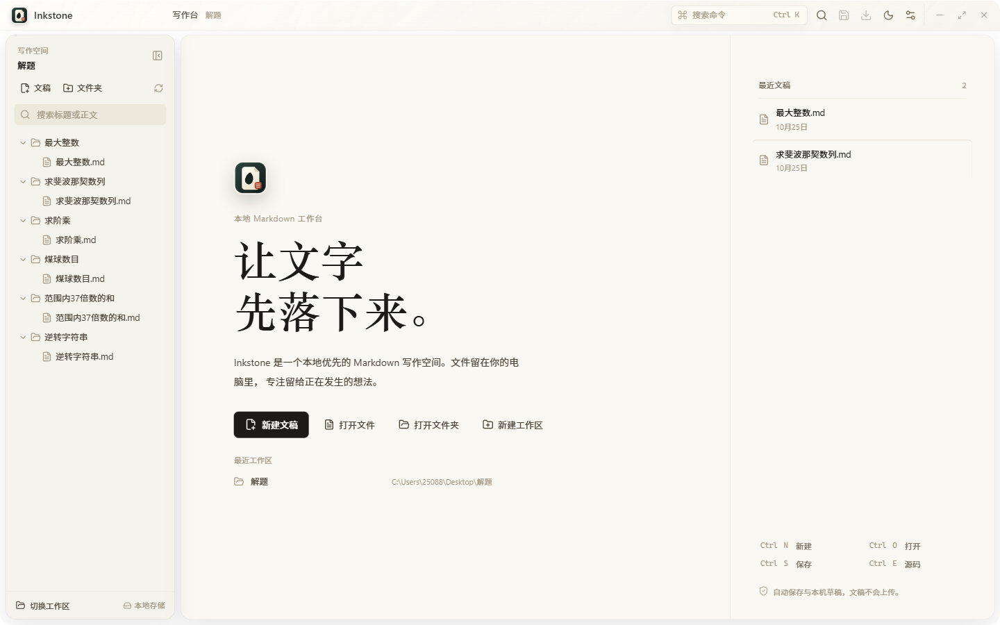

# Inkstone

一个用 Rust 与 Tauri 构建的本地优先 Markdown 写作工作台。界面与交互为原创实现，不复刻 Typora 的品牌、主题或专有资源。

> A local-first Markdown writing studio for Windows, built with Tauri 2, React 19, Rust and native Acrylic glass.



[下载 Windows 安装包](https://github.com/gkutrde/inkstone/releases/latest) · [设计文档](DESIGN.md) · [MIT License](LICENSE.txt)

## 下载

- Windows 10/11 x64 安装包与便携 ZIP 见 [GitHub Releases](https://github.com/gkutrde/inkstone/releases/latest)。
- 安装版为每用户安装，默认目录 `%LOCALAPPDATA%\Programs\Inkstone`，无需管理员权限。
- 当前公开发布包未做代码签名，Windows SmartScreen 可能提示未知发布者。

## 已实现

- Milkdown / ProseMirror 所见即所得编辑
- CodeMirror 6 Markdown 源码模式，`Ctrl+E` 切换
- 本地文件树、全文搜索、右键新建/重命名/回收站删除
- 多标签文稿，未保存状态提示
- 大纲、字词统计、阅读时间
- 查找与全部替换
- 表格、任务列表、代码块、图片、LaTeX 公式
- 纸白 / 旧纸 / 墨夜三种主题，字号与版心宽度可调
- 无边框一体化窗口、可拖动玻璃标题栏、原生 Acrylic/Mica 背景与 16px 原生圆角；透明模式可读性已单独调校
- DOCX、HTML、Markdown 副本导出；通过系统打印窗口另存 PDF
- DOCX 支持标题、列表、表格、代码、链接及常见本地图片嵌入
- 文件写入、目录扫描、图片落盘、搜索均由 Rust 后端执行
- 最近文稿与工作区记忆
- Ctrl+K 命令中心、最近命令与模糊搜索
- 可逆专注写作、快捷键帮助与全键盘导航
- 按需加载编辑器与导出模块，窄屏抽屉与完整弹层可访问性
- 已有文件停止输入后自动保存，保存队列避免乱序写入与误报
- 原子写入与磁盘版本冲突保护，外部修改不会被静默覆盖
- 未命名文稿保存为本机草稿，重新打开应用后可恢复

## 运行时性能

- 输入路径不再对整篇文档做 Markdown 序列化：编辑器只上报变更，快照按文档大小在停顿后生成；保存、模式切换、标签切换、导出、关闭、页面隐藏与 IME 组合结束前强制 flush。
- 真实 Tauri/WebView2（release）连续输入到下一帧 p95：31 KB 约 6 ms、251 KB 约 16 ms、1 MB 约 65 ms；连续输入期间无 >300 ms 长任务。
- 已知限制：1 MB 文档在保存/自动保存时仍有约 400 ms 的整篇序列化；大文档模式切换仍是重建编辑器。完整数据、对照与复现命令见 [TYPING-PERF-REPORT.md](TYPING-PERF-REPORT.md)。
- 性能探针与回归：`scripts/perf/`（`bench.py`、`typing_e2e.py`、`typing_ime_e2e.py`、`export_e2e.py`、`tauri_desktop_perf.py`、`tauri_soak.py`）。

## 安装

- 安装包 `Inkstone-Setup-<版本>-windows-x64.exe`：每用户安装（默认 `%LOCALAPPDATA%\Programs\Inkstone`），无需管理员权限。
- 安装器创建开始菜单与桌面快捷方式，并注册 `Inkstone.md` ProgID 与 `.md` / `.markdown` 的 OpenWith 条目；**不修改**系统当前的默认打开方式，可在应用命令中心打开 Windows“默认应用”设置自行确认。
- 卸载移除程序、快捷方式与 Inkstone 自有注册项；默认保留用户文档、设置与草稿，卸载页可显式勾选删除应用数据。
- 便携 ZIP 仅作为辅助分发；安装版与便携版共用同一应用数据目录，切换不会丢失草稿与设置。
- 双击 Markdown 文件或“打开方式 → Inkstone”会把文件交给已运行的窗口；单实例转发，不会重复启动。

## 快捷键

| 快捷键 | 功能 |
| --- | --- |
| `Ctrl+N` | 新建文稿 |
| `Ctrl+O` | 打开文件 |
| `Ctrl+Shift+O` | 打开文件夹 |
| `Ctrl+S` | 保存 |
| `Ctrl+Shift+S` | 另存为 |
| `Ctrl+W` | 关闭当前标签 |
| `Ctrl+F` | 查找 |
| `Ctrl+P` | 打印 / 另存 PDF |
| `Ctrl+E` / `Ctrl+/` | 切换所见即所得 / 源码 |
| `Ctrl+K` | 打开命令中心 |
| `Ctrl+Shift+D` | 切换专注写作 |
| `Ctrl+Tab` / `Ctrl+Shift+Tab` | 前后标签 |
| `F1` | 快捷键帮助 |
| `Shift+F10` | 文件树右键菜单 |
| `F3` / `Shift+F3` | 下一个 / 上一个匹配 |

## 开发

```powershell
npm install
npm run tauri dev
```

Windows release 构建可使用仓库中的 `build-app.cmd`（需要 Rust MSVC 工具链与 VS BuildTools）。

## 架构

- `src-tauri/src/lib.rs`：Rust 文件树、读写、搜索、图片保存与导出命令
- `src-tauri/src/file_io.rs`：原子写入、版本冲突检查与防覆盖创建
- `src-tauri/src/path_utils.rs`：单个路径组件与 Windows 名称安全校验
- `BACKEND-REVIEW.md`：本轮后端修复范围、测试结果与剩余架构边界
- `src/App.tsx`：工作区、标签页、保存、查找、设置与快捷键
- `src/components/RichEditor.tsx`：Milkdown 所见即所得编辑器
- `src/components/SourceEditor.tsx`：CodeMirror Markdown 源码编辑器
- `src/components/Sidebar.tsx`：文件树与全文搜索
- `src/styles.css`：原创视觉系统、商业组件、抽屉与打印样式
- `src/components/CommandCenter.tsx`：模糊搜索、最近命令与键盘执行
- `src/lib/useModalA11y.ts`：弹层焦点圈、Escape、焦点返回与快捷键隔离
- `src/lib/metrics.ts`：轻量大纲与统计
- `src/lib/editorMetrics.ts`：开发/测量态运行时探针（生产为空操作）
- `src/lib/editorScheduler.ts`：按文档大小的快照调度与 flush 边界
- `scripts/perf/`：性能基准、T0–T6 夹具、Tauri IPC 内存替身与打字/IME/导出回归
- `src/lib/export-html.ts`：按需 HTML 导出
- `DESIGN.md`：商业级设计原则、参考模式与验证基线
- `src/lib/docx-export.ts`：Markdown 到 DOCX 的结构转换、图片尺寸处理与本地打包
- `scripts/export-e2e.py`、`scripts/validate-export.py`：真实导出与 Word 结构验收

## 边界

- 不包含 Typora 的授权、激活或专有代码。
- 未命名草稿保存在本机 WebView 应用数据中；清除应用数据会删除这些草稿。
- Markdown 编辑基于开放式 Web 技术，但文件系统、搜索、图片和构建外壳由 Rust 执行。
- PDF 由系统打印窗口生成，不内置 PDF 渲染引擎。
- DOCX 可嵌入 PNG/JPEG/GIF/BMP；远程、SVG、WebP 图片以提示文字代替，公式以源码文本导出。

## 更新日志

见 [CHANGELOG.md](CHANGELOG.md)。

## License

MIT，详见 [LICENSE.txt](LICENSE.txt)。
