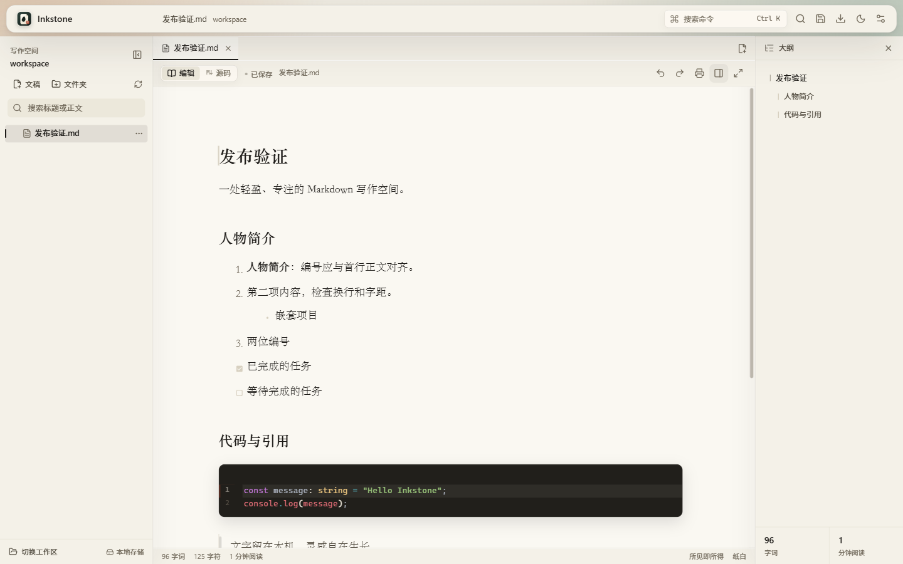
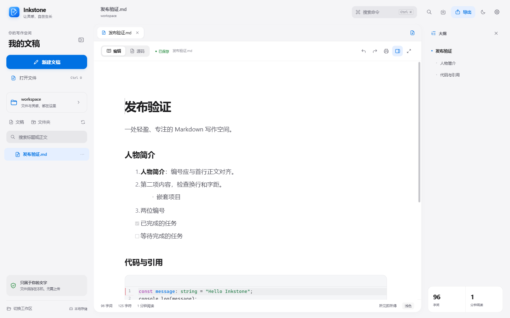
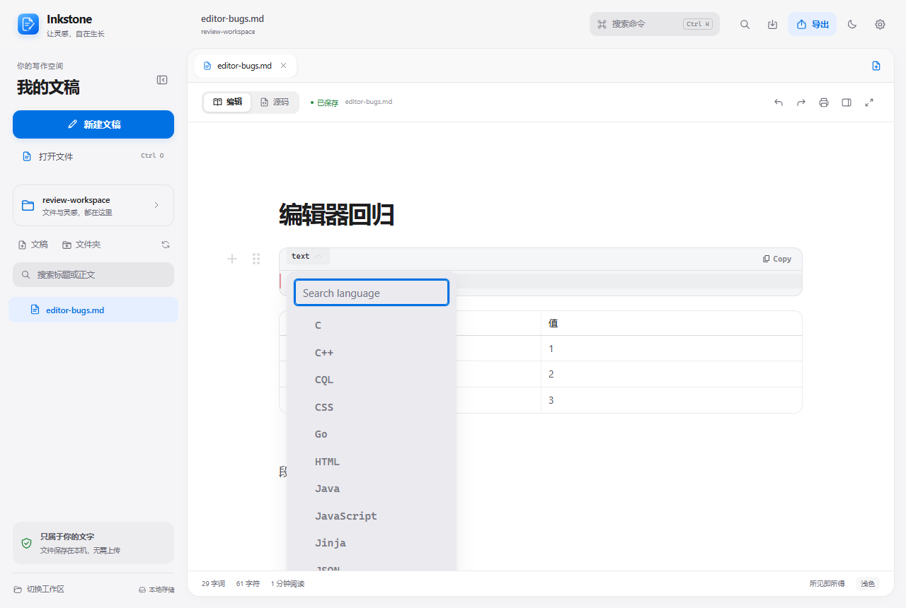
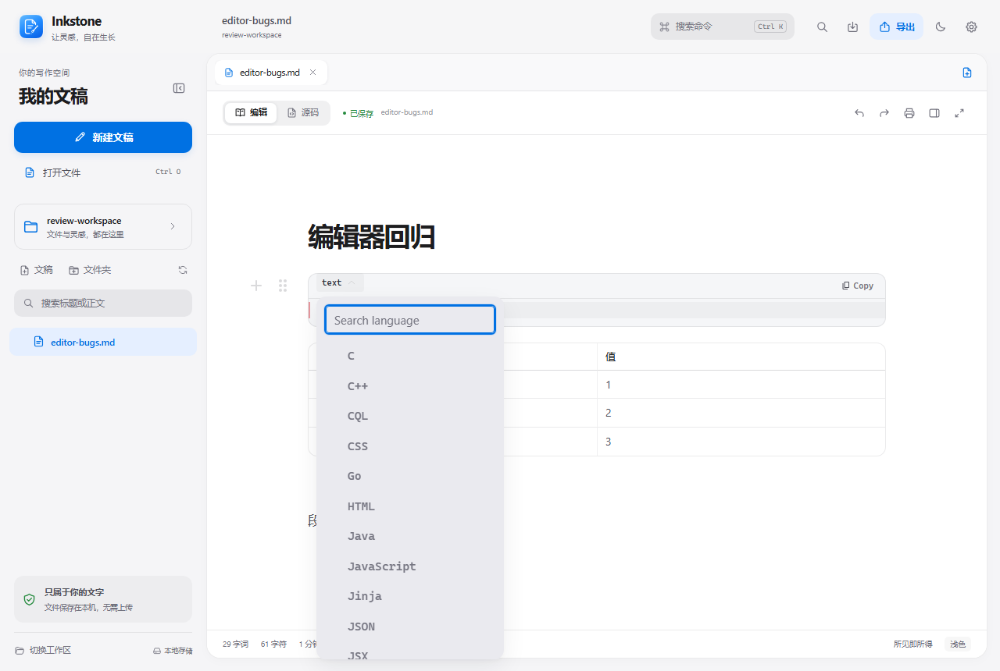

# Inkstone v0.1.3

Windows x64 发行记录。iOS 风格仅指视觉语言，应用仍为本地 Windows Markdown 编辑器。

## 本版更新

- 集成灰白分层、蓝色强调、圆角画布的 iOS 风格 Windows 界面；不是移动端移植。
- 新欢迎页、示例文稿、侧栏入口、细线 SVG 图标与随主题变化的代码高亮。
- 修正列表首行基线；修复代码语言列表被新画布裁剪的问题，保留筛选、滚动和原有主题色。
- Windows 安装图标、应用标识及草稿/设置存储键保持兼容。

## 本轮验证

| 检查 | 结果 | 范围 |
| --- | --- | --- |
| TypeScript 与生产构建 | 通过 | 最终前端源码 |
| 组件与存储回归 | 75 通过 / 0 失败 | SSR；不代替浏览器交互 |
| Markdown 语法回归 | 93 通过 / 0 失败 | 生产前端，浏览器 IPC 测试替身 |
| 综合、替换、剩余功能、编辑器专项 | 全部通过 | 真实 Chromium，IPC 测试替身 |
| Rust 后端 | 16 通过 / 0 失败 | 真实 Windows 文件读写与冲突保护 |
| Windows x64 EXE 与 NSIS | 构建成功 | GNU 工具链；未签名 |
| 真实桌面烟测 | 8 项通过 | 原生打开、中文路径保存、模式往返、自动保存、外部冲突与另存恢复 |
| 本地升级与安装版启动 | 通过 | 升级前 477 个数据文件哈希全部保留 |

Rust 测试使用同一 Rust 源码生成的真实测试程序，因 GNU 测试程序缺少 Windows Common Controls 激活清单而补充了清单；没有更改测试逻辑。浏览器测试中的 IPC 使用仓库内存替身；原生打开/保存对话框、实际磁盘写入、冲突保护及安装版启动由独立的 Windows 桌面测试验证。

Vite 的组件检查运行器和开发服务器不要同时共享依赖缓存；出现 Outdated Optimize Dep 时，停止测试开发服务器并使用 --force 重启后重跑。本轮已按该方式完整重跑通过。

## 视觉证据

主界面六组前后截图使用相同文稿、1440×900 视口、DPR 1、17px 字号、740px 版心、减少透明及禁用动画；覆盖浅色/深色欢迎页、编辑页、设置与命令中心。语言选择列表额外使用同一 1280×860 场景。

| 原版 | v0.1.3 |
| --- | --- |
|  |  |
|  |  |

## 发行资产

- Inkstone-Setup-0.1.3-windows-x64.exe
- Inkstone-0.1.3-windows-x64.zip
- Inkstone-0.1.3-source.zip
- SHA256SUMS.txt

打包只收集已跟踪源码；不会收录本地未跟踪的个人测试脚本、备份、浏览器配置或文稿。校验记录必须与待打包 EXE 的 SHA256 一致。

## 限制

- 未进行代码签名，SmartScreen 可能提示未知发布者；没有使用测试证书伪装正式签名。
- 尚未在干净 Windows 虚拟机或另一台机器复测。
- 仍有上游编辑器大分块（超过 500 kB）的构建提示，未进行新的运行时性能测量。
- README 中历史性能数据已单独标记，不作为 v0.1.3 的新测量结果。
