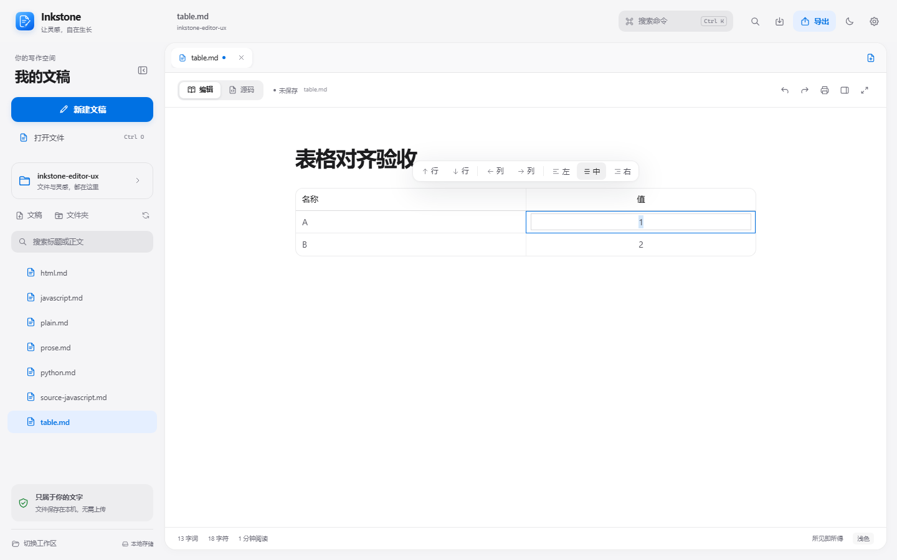
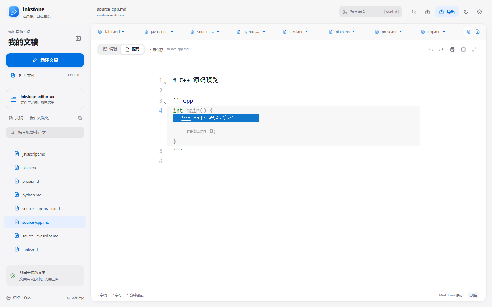
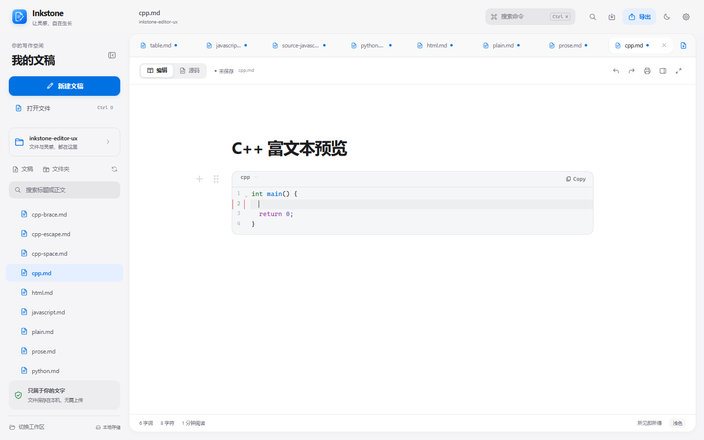

# Inkstone v0.1.4

Windows x64 发行记录。本版集中改进表格与代码编辑体验，应用仍为本地 Windows Markdown 编辑器。

## 本版更新

- 表格快捷工具条新增当前列居左、居中、居右，同步当前列表头与所有数据行，并正确写回 Markdown。
- 富文本与源码代码块统一支持语言感知换行缩进、Tab 接受补全、无候选时 Tab 缩进及 Shift+Tab 反缩进。
- 所有现有语言保留原生补全并支持文档词汇；JavaScript/TypeScript、Python、C/C++、HTML、CSS、JSON、Shell、SQL、YAML 增加本地代码片段。
- 输入暂停 500ms 后显示淡色完整多行预览；Tab 接受同一候选、Escape 关闭、继续输入重新计时。预览只是编辑器装饰，不参与保存或导出。
- C/C++ 支持 `int main()`、`return 0;`、头文件、条件、循环与输入输出模板。
- 在 `{}` 中间按 Enter 会展开为三行并缩进，大括号保持对齐；Space 仍输入普通的 `{ }`。

## 本轮验证

| 检查 | 结果 | 范围 |
| --- | --- | --- |
| TypeScript 与生产前端构建 | 通过 | 最终编辑器源码 |
| 编辑器体验端到端 | 通过 | 表格、双模式补全、500ms 预览、C++ 模板、Enter/Space、普通 Markdown 回归 |
| Markdown 语法回归 | 93 通过 / 0 失败 | Chromium，IPC 使用仓库测试替身 |
| 既有编辑器回归 | 通过 | 表格往返、语言选择、撤销重做、源码切换，无页面错误 |
| Rust 后端 | 16 通过 / 0 失败 | Windows GNU、Release/LTO，真实文件读写与冲突保护 |
| Windows x64 EXE 与 NSIS | 构建成功 | 独立 ASCII 构建副本、GNU Release；未签名 |

浏览器验收使用项目内存 IPC 替身，不代替真实 Windows 文件读写或安装验证。原生构建和当前用户安装结果以本文件后续记录及 BUILD-INFO.json 为准。

## 视觉证据

以下截图使用相同 1440×900 视口、浅色主题和固定测试文稿。预览接受前，文档仍只包含用户已经输入的内容。

| 表格当前列居中 | C++ 多行淡色预览 |
| --- | --- |
|  |  |

## 发行资产

- Inkstone-Setup-0.1.4-windows-x64.exe
- Inkstone-0.1.4-windows-x64.zip
- Inkstone-0.1.4-source.zip
- SHA256SUMS.txt

打包只收集已跟踪源码；不收录本地未跟踪的个人测试脚本、浏览器配置或真实文稿。发布验证记录中的 EXE 哈希必须与实际构建一致。

## 限制

- 安装包与主程序未做 Authenticode 签名，Windows SmartScreen 可能提示未知发布者。
- 补全来自本地语言包、文档词汇和代码片段，不接入 AI 或 LSP，不提供跨文件语义推断。
- 尚未在另一台干净 Windows 机器上复测。
- 构建仍有上游编辑器大分块提示，本轮未进行拆包或新的性能测量。
