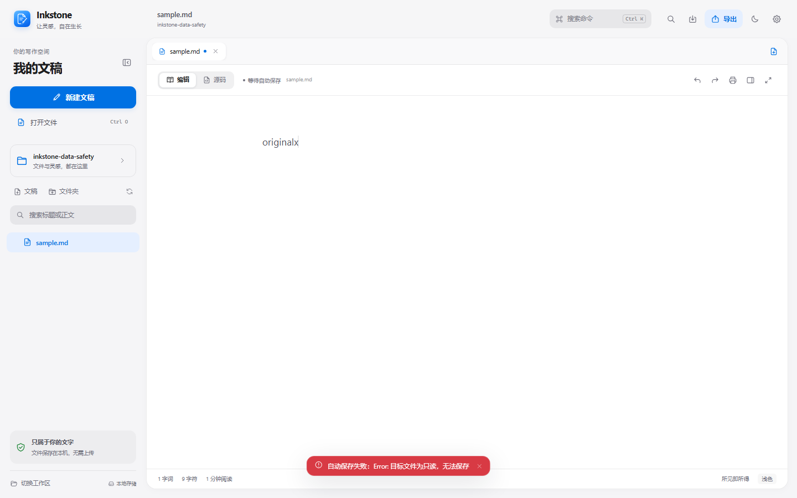
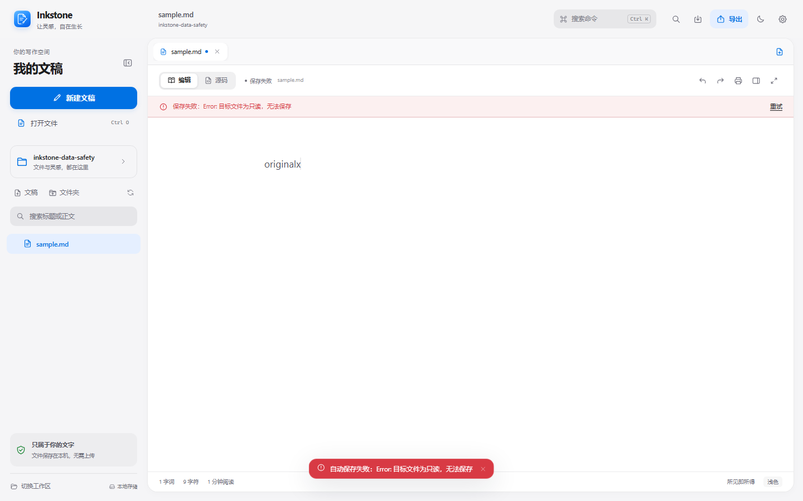
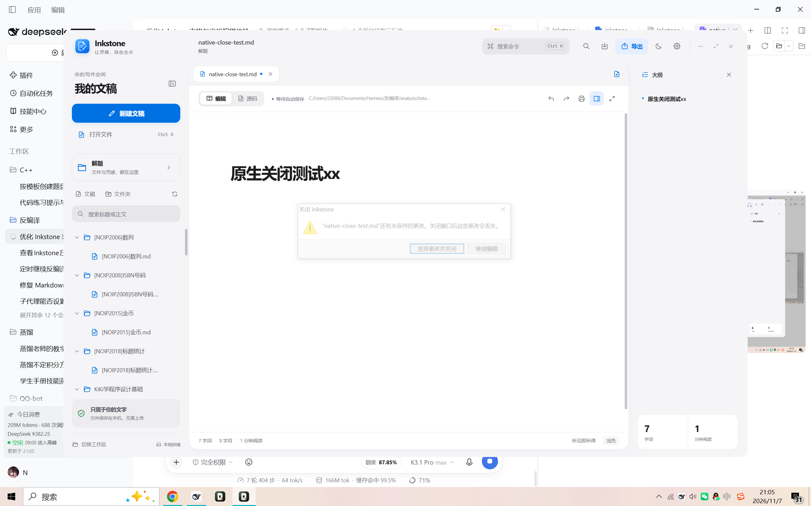

# Inkstone v0.1.5

Windows x64 发行记录。本版集中修复数据保护与保存可靠性，不改变既有文档格式和编辑习惯。

## 本版更新

- 另存为选回原路径时继续使用打开文稿时的版本信息校验磁盘；外部修改或删除仍触发冲突，真正另存到新路径不受影响。
- 富文本“全部替换”只替换可见正文，前言、引用定义和其他隐藏源码不再被不可见命中改写。匹配计数与实际替换一致，并保持一次可撤销事务。
- Alt+F4、任务栏“关闭窗口”和其他系统关闭请求统一进入未保存确认；取消后保留编辑器，确认后通过不递归的 `destroy()` 退出。
- 自动保存普通失败显示持久错误状态和错误横幅，按 2s / 4s / 8s 最多自动重试三次，仍失败时保留手动“重试”。
- 弹窗、查找栏、命令中心、侧栏与全局快捷键统一识别 IME 组字事件，避免 Esc、Enter、方向键或 Ctrl 命令误触。

## 本轮验证

| 检查 | 结果 | 范围 |
| --- | --- | --- |
| 批次 A 数据安全端到端 | 全部通过 | 同路径冲突、外部删除、可见替换、持久错误、退避与手动恢复、IME 组字 |
| 编辑器体验回归 | 全部通过 | 表格、双模式代码补全、多行预览、C/C++ 模板、Enter/Space、普通 Markdown 行为 |
| Markdown 语法回归 | 93 通过 / 0 失败 | Chromium，IPC 使用仓库测试替身 |
| 既有编辑器与替换回归 | 全部通过 | 模式往返、撤销重做、替换落地与字面替换字符 |
| Rust 后端 Release 测试 | 16 通过 / 0 失败 | Windows GNU Release，真实文件读写与冲突保护 |
| 原生系统关闭 | 取消与确认均通过 | 独立临时进程、真实 WM_CLOSE 与原生确认按钮 |
| Windows x64 EXE 与 NSIS | 构建成功 | 独立 ASCII 构建副本、GNU Release；未签名 |

浏览器故障注入和 IPC 替身仅用于可控回归，不代替真实磁盘错误。系统关闭使用真实临时原生窗口，未替换当前本地安装。没有执行另一台干净 Windows 机器验证。

## 视觉证据

保存失败在同一场景、1440×900、浅色主题下由临时 toast 变为持久错误横幅和“重试”入口。

| Before | After |
| --- | --- |
|  |  |

| 取消关闭 | 确认关闭 |
| --- | --- |
|  |  |

## 发行资产

- Inkstone-Setup-0.1.5-windows-x64.exe
- Inkstone-0.1.5-windows-x64.zip
- Inkstone-0.1.5-source.zip
- SHA256SUMS.txt

打包只收集已跟踪源码，不包含本地未跟踪的个人脚本、浏览器配置或真实文稿。发布验证记录中的 EXE 哈希必须与最终构建一致。

## 限制

- 安装包与主程序未做 Authenticode 签名，Windows SmartScreen 可能提示未知发布者。
- 本次只发布到 GitHub，未执行当前用户的覆盖安装验证。
- 构建仍有上游编辑器大分块提示，本轮未进行拆包或新的性能测量。
- WebView2 CDP 调试端口在部分运行环境不可用；原生关闭验收改用 Win32 窗口与按钮，不宣称 CDP 渲染探针通过。
