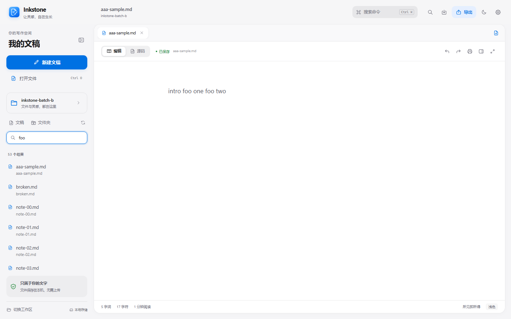
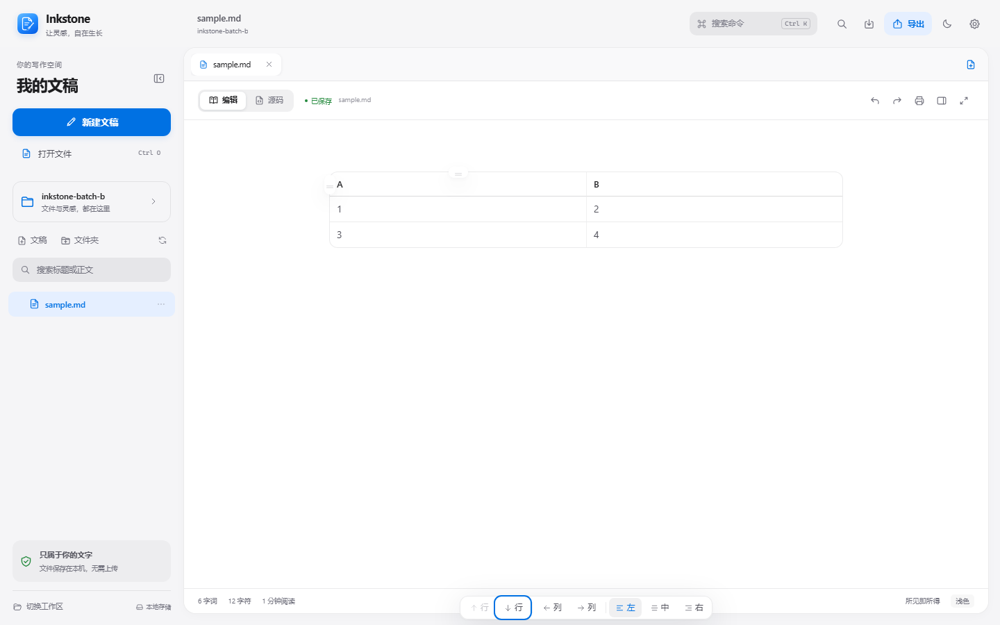
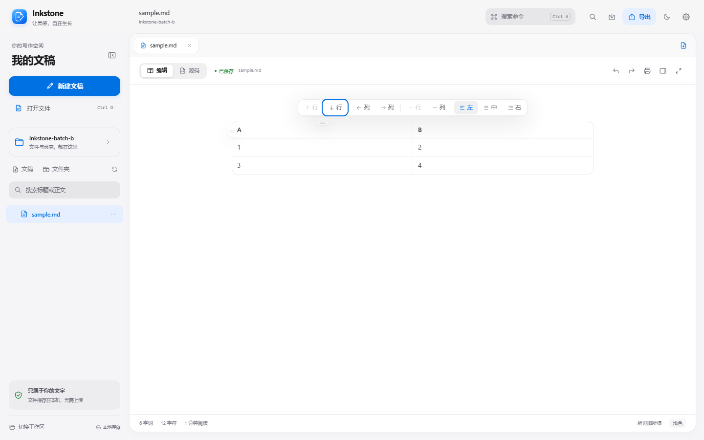
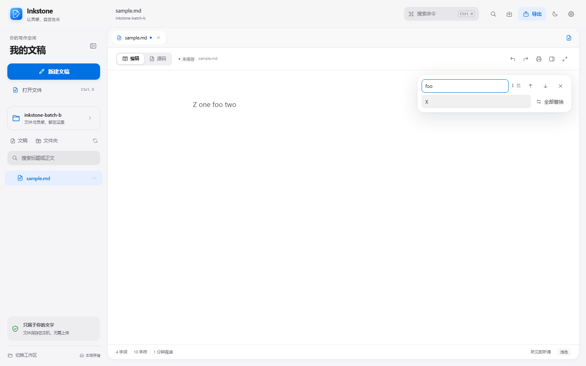

# Inkstone v0.1.6

Windows x64 发行记录。本版集中提升搜索、替换、表格与长文导航等高频写作效率，不改变既有文档格式、应用标识或本地优先策略。

## 本版更新

- 工作区搜索展示首个命中片段、行号和命中数；达到 50 个文件时明确标记截断，并单独提示超过 2 MiB 或无法按 UTF-8 读取的文件。
- 每个标签和编辑模式分别保存滚动位置；长文切换标签或源码/富文本后回到原位置。
- 富文本与源码模式都支持单处替换，优先替换当前匹配，未选中匹配时替换第一处；查找跳转后输入仍留在查找栏。
- 文件或文件夹重命名、删除后同步最近文稿、最近工作区与当前工作区，不再保留或读取失效路径。
- 大纲忽略 HTML 注释中的伪标题，同时继续跳过代码围栏内容。
- 常用语言代码片段统一使用每级 2 个空格；仅作用于后续插入，不批量改写旧文档。
- 表格快捷工具条新增删除当前行/列，并禁止删除表头行、最后数据行和最后一列。
- Shift+Enter 在表格单元格内插入软换行，保存为 ` `，重新加载后仍可继续编辑。

## 本轮验证

| 检查 | 结果 | 范围 |
| --- | --- | --- |
| 批次 B 浏览器验收 | 全部通过 | 搜索截断与跳过、表格删除行列与软换行往返、双模式单处替换、最近路径同步、标签/模式滚动、注释大纲 |
| 批次 A 数据安全端到端 | 全部通过 | 同路径冲突、外部删除、可见替换、持久错误、退避与手动恢复、IME 组字 |
| 编辑器体验回归 | 全部通过 | 表格对齐、双模式代码补全、多行预览、C/C++ 模板、Enter/Space、代码片段精确 2 空格缩进 |
| Markdown 语法回归 | 93 通过 / 0 失败 | Chromium，IPC 使用仓库测试替身 |
| 既有编辑器与替换回归 | 全部通过 | 模式往返、撤销重做、替换落地、隐藏源码保护、剩余功能 |
| 最近路径纯函数单测 | 10 通过 / 0 失败 | 文件/目录重命名、删除、大小写与路径边界 |
| Rust 后端 Release 测试 | 17 通过 / 0 失败 | Windows GNU Release，真实文件读写与冲突保护 |
| Windows x64 EXE 与 NSIS | 构建成功 | 独立 ASCII 构建副本、GNU Release；未签名 |
| 当前用户覆盖安装 | 通过 | 从 0.1.4 升级至 0.1.6，文件版本、真实窗口启动和用户数据目录均已验证 |

浏览器故障注入和 IPC 替身仅用于可控回归，不代替真实磁盘错误。本地替换使用当前用户安装目录进行覆盖升级，未清除草稿、文稿或设置。没有执行另一台干净 Windows 机器验证。

## 视觉证据

以下对比均在 1440×900、浅色主题和相同验收场景下采集；Before 来自 v0.1.5 的同一份验收脚本。

| 搜索 Before | 搜索 After |
| --- | --- |
|  |  |

| 表格 Before | 表格 After |
| --- | --- |
|  |  |

| 查找 Before | 查找 After |
| --- | --- |
|  |  |

Before 中搜索只有文件路径，表格没有删除按钮，查找跳转后继续输入会写入正文。After 显示搜索片段/行号/命中数与截断提示、表格删除按钮，以及单处替换按钮和保留在查找栏的焦点。

## 发行资产

- Inkstone-Setup-0.1.6-windows-x64.exe
- Inkstone-0.1.6-windows-x64.zip
- Inkstone-0.1.6-source.zip
- SHA256SUMS.txt

打包只收集已跟踪源码，不包含本地未跟踪的个人脚本、浏览器配置或真实文稿。发布验证记录中的 EXE 哈希必须与最终构建一致。

## 限制

- 安装包与主程序未做 Authenticode 签名，Windows SmartScreen 可能提示未知发布者。
- 本轮只验证当前 Windows 用户的覆盖安装，没有执行另一台干净 Windows 机器或全局安装验证。
- 构建仍有上游编辑器大分块提示，本轮未进行拆包或新的性能测量。
- 搜索最多展示 50 个匹配文件；超出后会明确标记截断，需要缩小关键词继续搜索。
