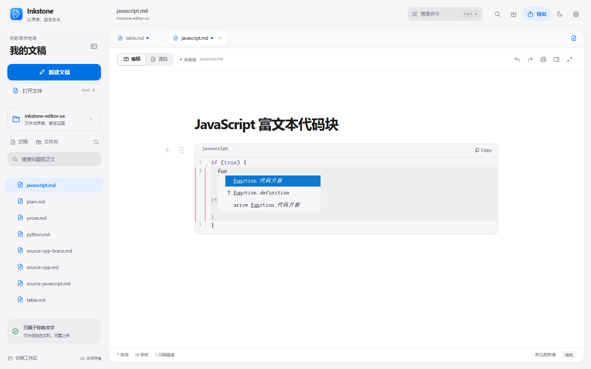
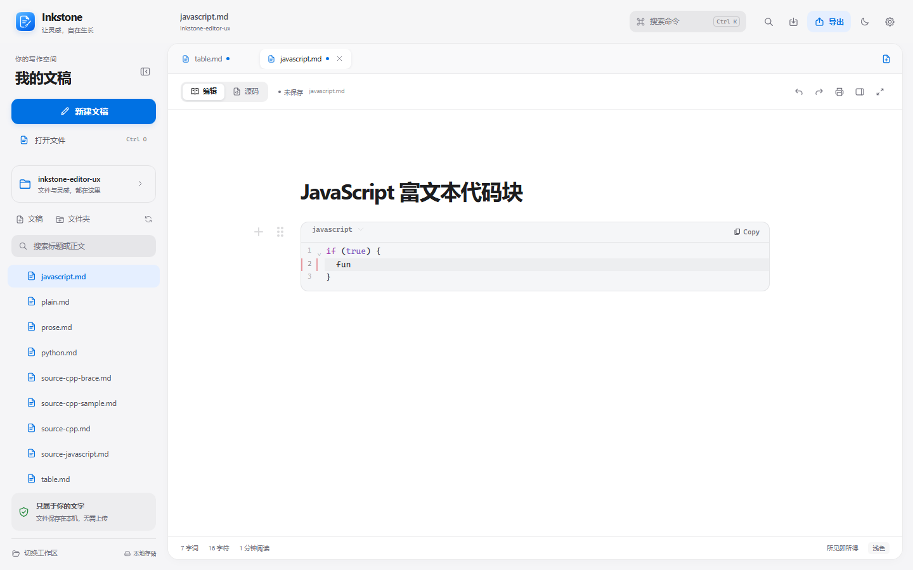
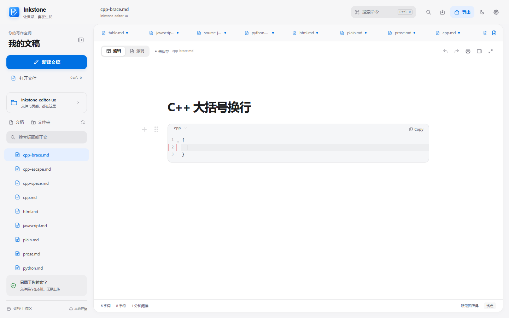
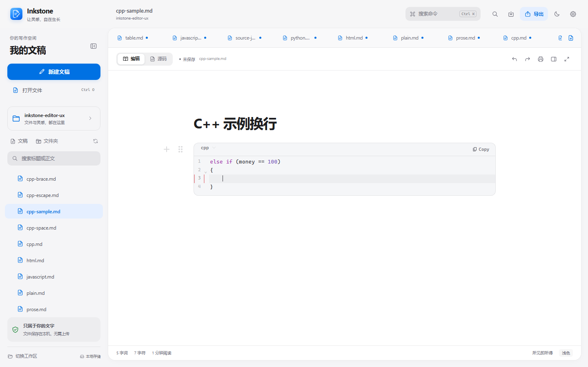

# Inkstone v0.1.7

Windows x64 发行记录。本版修正 C++ 代码输入格式，并统一关闭代码块补全提示，不改变文档格式、应用标识或本地优先策略。

## 本版更新

- C++ 的 if、else if、else、for、while 和函数等代码块统一使用 Allman 风格：左大括号独占下一行，块内每级 4 个空格，右大括号与语句对齐。
- 在条件后输入左大括号并按 Enter 时，自动把大括号移到下一行，并在块内放置 4 空格缩进。
- 所有代码语言关闭建议弹窗、幽灵预览、代码片段、显式补全快捷键及补全 Tab/Enter 行为。
- 括号自动闭合仍然保留；Tab 恢复为纯缩进，Shift+Tab 反缩进。
- C++ 格式只作用于后续输入，不批量改写已有代码块；其他语言继续使用原有 2 空格缩进。

## 本轮验证

| 检查 | 结果 | 范围 |
| --- | --- | --- |
| 编辑器体验回归 | 全部通过 | C++ 富文本/源码 Allman 四空格、全语言无补全与幽灵预览、括号自动闭合、Tab 缩进 |
| 批次 B 浏览器验收 | 全部通过 | 搜索、表格、替换、最近路径、滚动与大纲 |
| 批次 A 数据安全端到端 | 全部通过 | 冲突保护、可见替换、保存重试、IME 组字 |
| 既有编辑器与替换回归 | 全部通过 | 模式往返、撤销重做、替换落地、隐藏源码保护 |
| Markdown 语法回归 | 93 通过 / 0 失败 | Chromium，IPC 使用仓库测试替身 |
| Rust 后端 Release 测试 | 17 通过 / 0 失败 | Windows GNU Release，真实文件读写与冲突保护 |
| Windows x64 EXE 与 NSIS | 构建成功 | 独立 ASCII 构建副本、GNU Release；未签名 |
| 当前用户覆盖安装 | 通过 | 从 0.1.6 升级至 0.1.7，文件版本、真实窗口启动和用户数据目录均已验证 |

浏览器验收使用项目内存 IPC 替身，不代替真实 Windows 文件读写。没有执行另一台干净 Windows 机器验证。

## 视觉证据

以下对比均在 1440×900、浅色主题和相同验收场景下采集；Before 来自 v0.1.6。

| 补全 Before | 补全 After |
| --- | --- |
|  |  |

| C++ 大括号 Before | C++ 大括号 After |
| --- | --- |
|  |  |

Before 中 JavaScript 输入会弹出代码片段候选，C++ 空块使用两空格。After 中补全提示完全消失，C++ 条件后的大括号移到独立行并使用四空格。

## 发行资产

- Inkstone-Setup-0.1.7-windows-x64.exe
- Inkstone-0.1.7-windows-x64.zip
- Inkstone-0.1.7-source.zip
- SHA256SUMS.txt

打包只收集已跟踪源码，不包含本地未跟踪的个人脚本、浏览器配置或真实文稿。发布验证记录中的 EXE 哈希必须与最终构建一致。

## 限制

- 安装包与主程序未做 Authenticode 签名，Windows SmartScreen 可能提示未知发布者。
- 本轮只验证当前 Windows 用户的覆盖安装，没有执行另一台干净 Windows 机器或全局安装验证。
- 自动格式只处理新输入的 C++ 换行，不提供整篇代码格式化器，也不会重排已有代码。
- 构建仍有上游编辑器大分块提示，本轮未进行拆包或新的性能测量。
